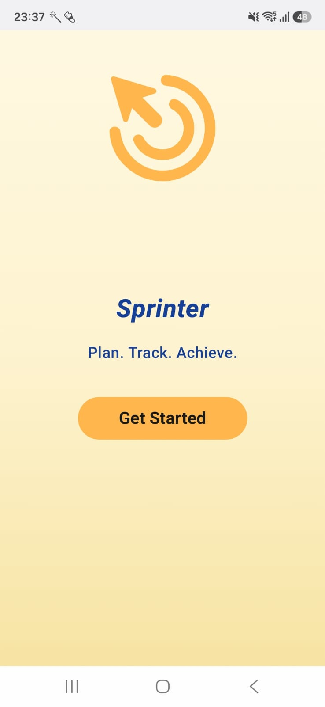
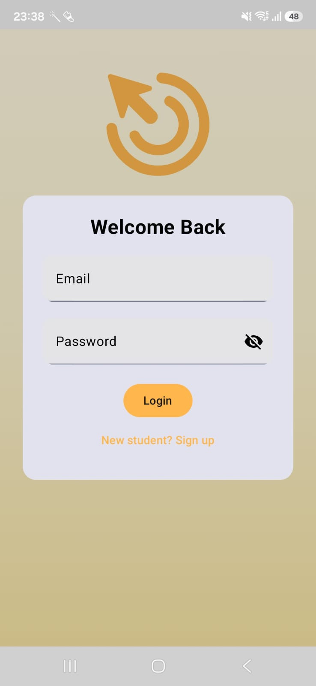
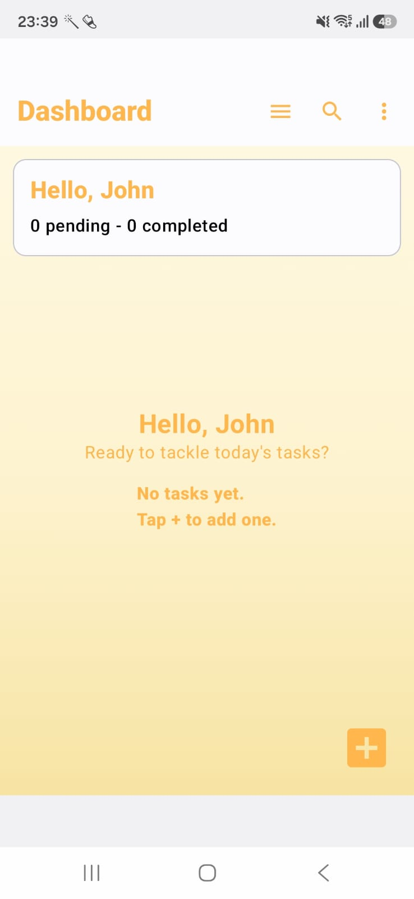
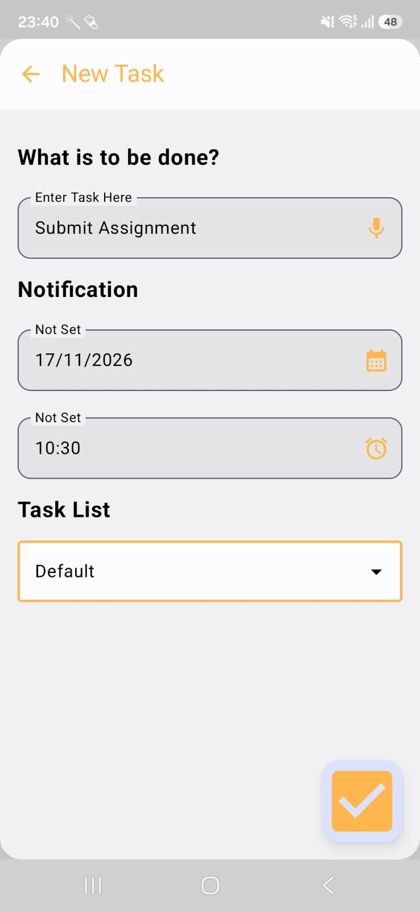
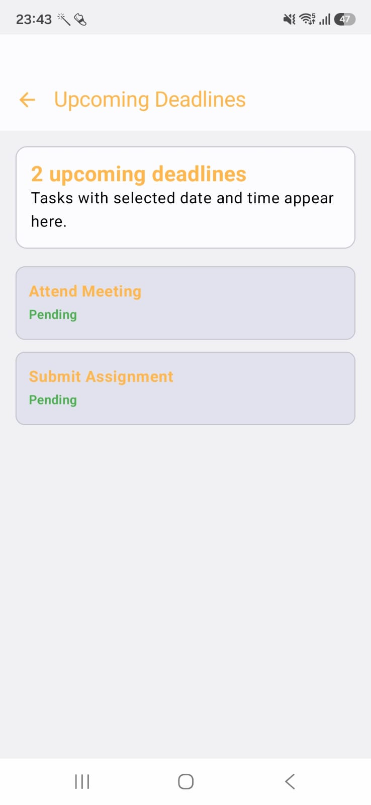
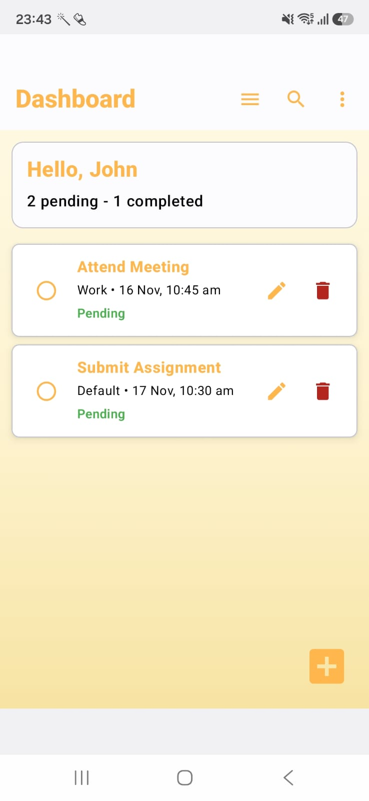
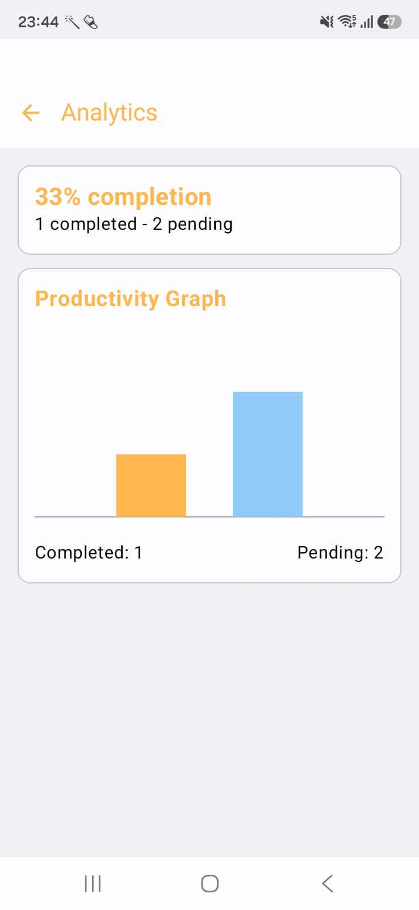
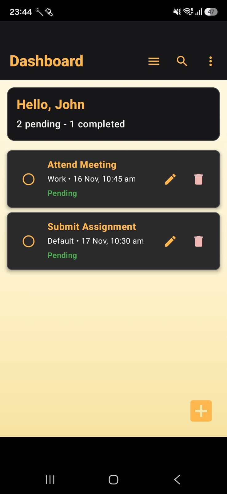
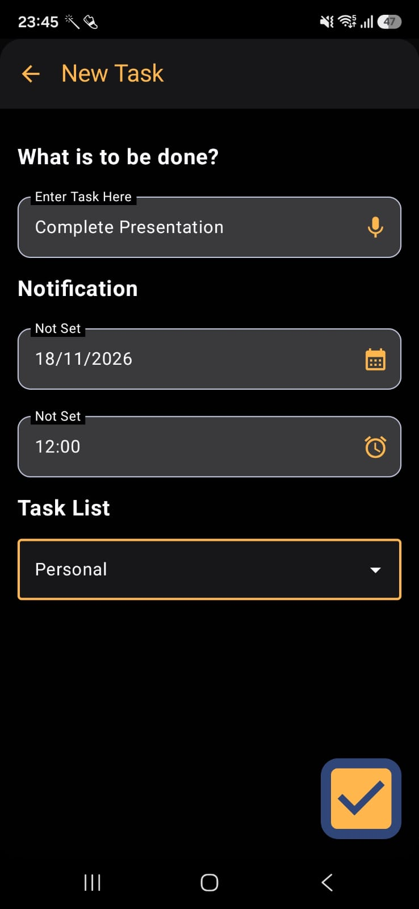
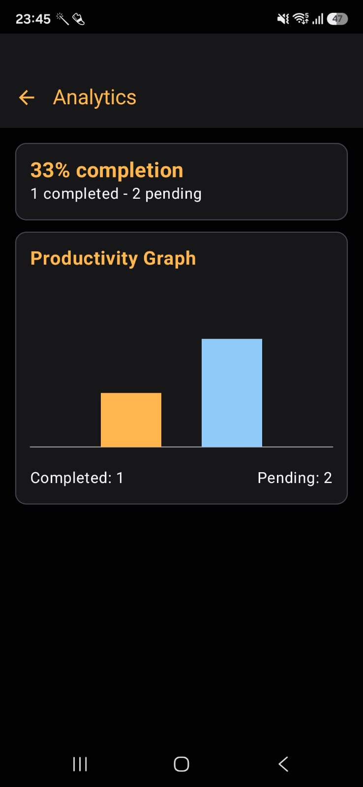

# Student Task Management Application

## Overview

This app helps students keep track of daily and upcoming academic tasks with a clean dashboard and simple workflow. It supports task creation, status tracking, deadline visibility, and notifications to help stay on top of responsibilities.

## Key Features

- Create and manage tasks
- Track task status as pending, ongoing, or completed
- View deadlines and upcoming work clearly
- Get reminder notifications
- Monitor summary analytics from the dashboard
- Use a modern UI with reusable components

## Tech Stack

- Kotlin
- Jetpack Compose
- Android Studio
- Gradle

## Project Structure

```text
student-task-manager-application/
├── app/
│   ├── src/
│   │   ├── main/
│   │   │   ├── java/
│   │   │   ├── res/
│   │   │   └── AndroidManifest.xml
│   │   └── test/
│   └── build.gradle.kts
├── gradle/
│   └── wrapper/
├── build.gradle.kts
├── gradlew
├── gradlew.bat
├── settings.gradle.kts
├── README.md
└── gradle.properties
```

## Main App Areas

- `components/` — reusable UI pieces like dialogs, fields, and task cards
- `data/` — models, repositories, and database logic
- `screens/` — dashboard, deadlines, analytics, and authentication screens
- `notifications/` — reminder scheduling and task alerts
- `ui/theme/` — app colors, typography, and theme definitions

## Getting Started

1. Open the project in Android Studio.
2. Let Gradle sync the project dependencies.
3. Connect an emulator or Android device.
4. Run the app from the `app` module.

## Run Commands

```bash
./gradlew assembleDebug
./gradlew installDebug
```

## Goal of Student Task Management Application

A smart productivity companion for students by helping them manage tasks, improve focus, maintain consistency, and achieve better academic organization.

## License

This project is for educational and personal use unless otherwise specified by the repository owner.

## Screenshots

### Welcome Screen and Login/Sign Up Authentication
<p text-align="center">
  
  
</p>

### Dashboard and Adding Tasks
<p text-align="center">
   
  
</p>

### Deadlines, Completed Tasks and Analytics
<p text-align="center">
  
  
  
</p>

### Dark Preview

<p text-align="center">
  
  
  
</p>
